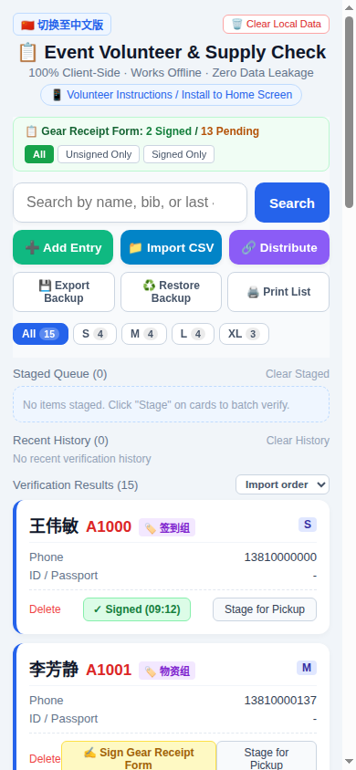
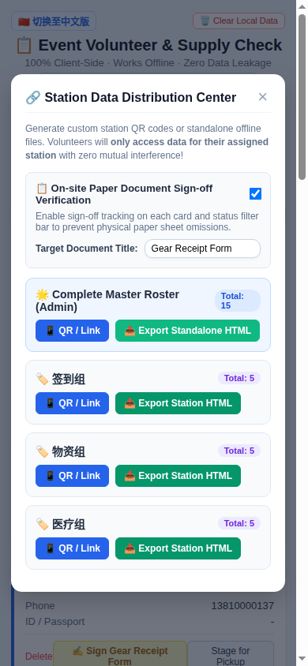
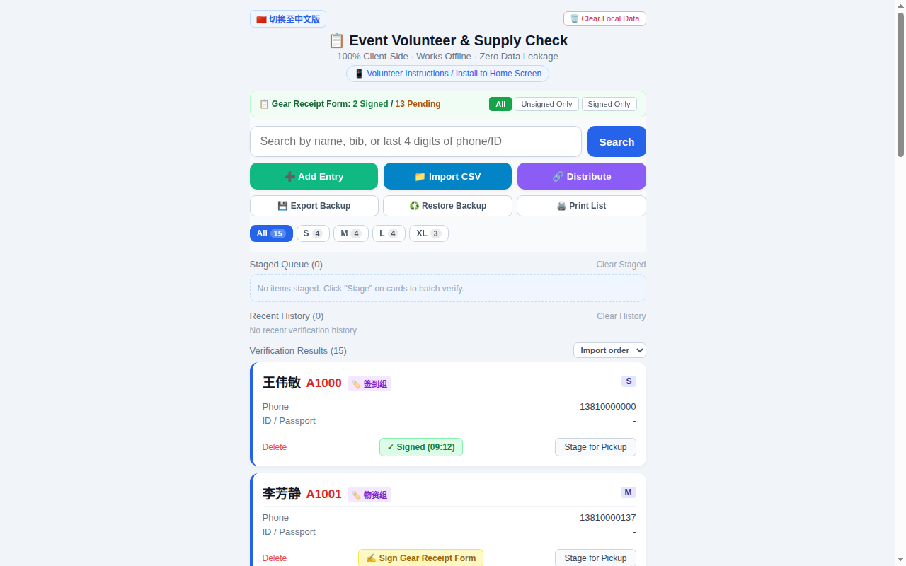
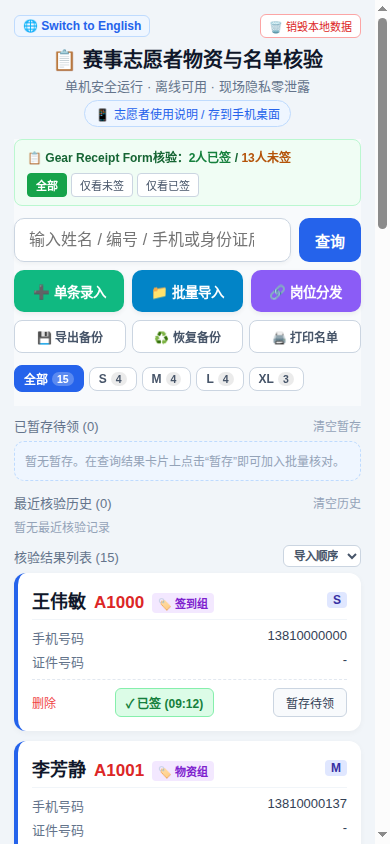

# Event Roster & Material Distribution Tool

[简体中文](README_zh.md) | [Live Demo (English)](https://zhengjack88.github.io/event-roster-tool/) | [Live Demo (Chinese)](https://zhengjack88.github.io/event-roster-tool/index_zh.html)

> 🏃 **Engineered for large-scale sports events (marathons, trail races, cycling tours, festivals).**  
> Enables instant volunteer roster verification, material distribution, clothing size tallying, and isolated station/group dispatching.  
> Pure front-end single-file architecture: **zero backend, zero dependencies, zero configuration, and 100% offline-ready**.

---

## 📸 Screenshots

**Mobile — roster cards with sign-off status**


**Station distribution center — QR code or standalone HTML per group**


**Desktop view**


**Chinese version**


---

## 🌟 Key Features (v2.2)

### 0. 🆕 What's new in v2.2
- **Full JSON backup & restore**: export roster, paper sign-off records, sign-off settings, recent history and staged queue into one dated `roster-backup-YYYY-MM-DD.json` file, and restore it in one tap (with an explicit overwrite confirmation) after clearing browser cache or switching devices.
- **GBK-aware CSV import**: files are read as raw bytes — UTF-8 is detected first (BOM included) and GBK is used automatically when needed, so CSV files re-saved from Chinese Excel no longer produce garbled names. The detected encoding is shown in the import dialog.
- **RFC 4180 CSV parser**: a proper character-level state machine handles `""` escaped quotes and newlines inside quoted cells, and warns about suspected duplicates (same name + phone, or same bib number) before importing.
- **Chinese header auto-recognition**: CSV column headers in Chinese (姓名、电话、号码簿、分组、尺码、身份证) are now auto-mapped to the right fields, alongside the existing English keywords — no more manual column selection for Chinese rosters.
- **QR capacity protection**: if a group's compressed payload exceeds 2000 characters, QR generation is blocked with a clear explanation and a one-click switch to the standalone HTML export instead of a cryptic `Too long data` failure.
- **Sign-off state travels with distribution**: exported station files and QR links now carry that group's paper sign-off records plus the sign-off setting, so a receiving phone immediately shows who has already been checked off.
- **Print support**: a print button renders just the currently filtered roster, with a header showing group, date and headcount.
- **Sorting**: sort the result list by name, group or clothing size — import order remains the default.
- **Result cap notice**: when a filter matches more than 60 people the list says exactly how many matched, instead of silently showing 60 cards.
- **iOS home-screen icon**: a proper 180×180 `apple-touch-icon.png` replaces the page-screenshot icon.

### 1. 🔗 Manager Station Distribution Center (Data Isolation)
- **Automatic Group Extraction**: Automatically parses and groups volunteers/participants by department or station (e.g., Check-in, Material Handout, Medical Post, Timing Station).
- **📦 One-Click Standalone HTML Export**: Managers can export self-contained, pre-baked HTML files for any specific station (e.g., `Event_Checkin_Station.html`). Shared via chat or email, volunteers opening this file can only access their assigned station roster — ensuring airtight physical data isolation. The file also carries that group's paper sign-off state (v2.2).
- **📱 Scan-to-Go QR Data Transfer**: Powered by LZ-String high-efficiency compression, roster subsets are encoded directly into QR codes or custom URLs. Volunteers can scan the QR code via WeChat or camera to cache their group's roster locally — fully functional even with zero cell service. Groups too large for a QR code are offered the HTML export instead (v2.2).

### 2. 📲 Native iOS / Safari Experience (PWA Fullscreen App)
- **Zero App Store Downloads**: Fully compliant with PWA specifications, including step-by-step onboarding modal guides.
- **Add to Home Screen**: Volunteers can tap Safari's "Share ➡️ Add to Home Screen" to install a permanent app icon.
- **Clean Fullscreen View**: Runs without browser address bars or navigation menus, looking and feeling just like a native app.

### 3. 📁 Smart CSV Import & Dynamic Header Mapping
- Flexible fuzzy column detection for various CSV/Excel headers (Name, Phone, Group/Station, Clothing Size, Bib/ID, Remarks).
- Encodings are auto-detected: UTF-8 first, GBK fallback for CSV files re-saved from Chinese Excel (`v2.2`).
- Standards-compliant CSV parsing (quoted `""` escapes, multi-line cells) with a duplicate warning before import (`v2.2`).
- Live data staging with one-click persistence to browser `localStorage` to prevent accidental data loss.

### 4. ⚡ Millisecond Multi-Dimensional Search
- Instant fuzzy/exact search across **Name**, **Phone (supports last 4 digits)**, **Bib / Badge ID**, and **Personal ID**.
- Mobile-optimized "✕ Quick Clear" button for rapid on-site lookups.
- Clothing size facets (S / M / L / XL / 2XL / 3XL) with real-time headcounts.
- Sort results by name, group or size, and print the current filtered list (`v2.2`).

### 5. 🔒 Complete Privacy & Data Security
- **100% Client-Side**: No backend API calls or telemetry tracking. Roster data never leaves the user's browser.
- One-tap JSON backup and restore so a cleared cache or a new phone never costs you the roster (`v2.2`).
- Emergency "Clear Cache" button to instantly destroy sensitive event data after the race.

---

## 🚀 Quick Start

### Live Demos
- [Live Demo (English)](https://zhengjack88.github.io/event-roster-tool/)
- [Live Demo (Chinese)](https://zhengjack88.github.io/event-roster-tool/index_zh.html)

### Manager Workflow
1. Open the tool, click **"📁 Import CSV"**, and select your event roster.
2. Confirm header mapping and import data.
3. Open **"🔗 Station Distribution"**:
   - **Method A (Chat File Transfer)**: Click **"📦 Export [Group] Standalone HTML"** and send the file directly to your team chat.
   - **Method B (On-Site QR Scanning)**: Click **"📱 QR Code / Link"**; volunteers scan the code to download their station's roster directly into their phone's local storage.

### Volunteer Workflow (Mobile)
1. Open the received HTML file or scan the QR code.
2. In iOS Safari, tap the **Share** button ➡️ **"Add to Home Screen"**.
3. Launch from the home screen for an offline, fullscreen search tool.

---

## 📄 Sample Test Data

Sample CSV schema (`test.csv`):
```csv
Name,Phone,Group,Station,Size,Bib,Remarks
John Doe,13800138001,Check-in,Main Gate,L,VIP-001,Team Lead / Radio 01
Jane Smith,13800138002,Check-in,VIP Lane,M,VOL-002,Armband
Mike Brown,13800138003,Materials,T-Shirt Booth,XL,MAT-001,Size Exchange
Sarah Lee,13900139001,Medical,Finish Line,S,MED-001,First Aid Certified
```

---

## ⚖️ Intellectual Property & Licensing (License & Terms)

This project is licensed under a **Source-Available Proprietary License**:

1. **Personal & Non-Commercial Use**: Anyone may freely view the source code, download it, and use it for volunteer event operations free of charge.
2. **Resale & Commercial Redistribution Prohibited**: **Third parties are strictly prohibited from reselling this software, repackaging it for fee-based services, or bundling it into paid commercial solutions.**
3. **Exclusive Commercial Rights**: **The original author (`zhengjack88`) retains the sole and exclusive right to commercially sell, license, redistribute, and monetize this software and its derivative works.**

For commercial partnerships or customized enterprise deployments, please contact the author.

---

## 🎗️ Public Welfare Initiative

> **"A tiny spark can light the way for others."**  
> 
> This tool is enthusiastically open and free for **charity races, non-profit runs, community volunteering, and youth sports events**.  
> The author gladly provides ongoing **pro bono technical support and customizations** to non-profit organizations.  
> 
> If this tool assists your volunteer team, we would be deeply honored to receive an **electronic volunteer service certificate or letter of appreciation** upon event completion as a token of remembrance.  
> *Contact: Feel free to reach out via GitHub Issues or author profile.*
